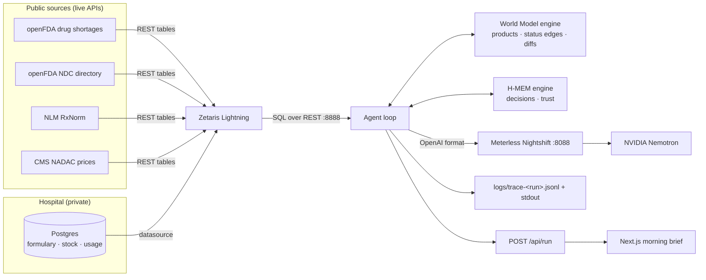
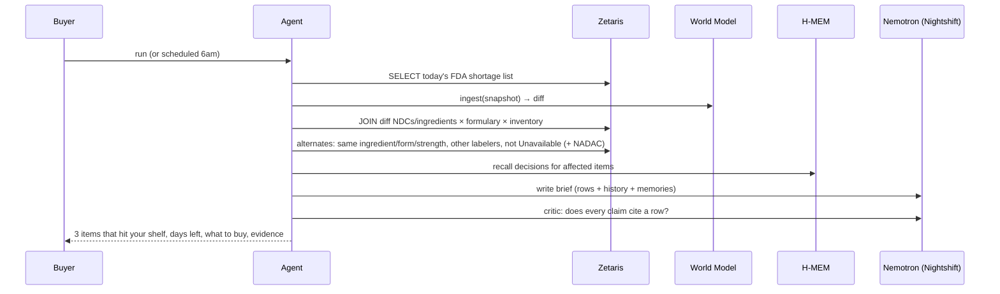

# Shortage Radar — Architecture

> **750 shortage updates a week. Three of them hit your shelf. Here is what to buy instead, and why.**

Open Agent Hackathon 2026 · Track 02, *The Agent That Can Explain Why*.

## 1. Pitch

The FDA drug shortage list is the source of truth for US drug supply, and it is noisy: in the week to 22 Oct 2026, **746 of its 1,609 entries changed**. Each entry is one package NDC from one company, marked Available, Limited or Unavailable. A hospital pharmacy buyer has to work out, every morning, which of those changes touch *their* formulary, how many days of stock they have left, and which NDC from which manufacturer they can buy instead.

Shortage Radar is an agent that does that triage. It joins the hospital's own formulary and stock (a private database) with the FDA shortage list, the FDA NDC directory, RxNorm and CMS NADAC prices through **Zetaris**, tracks every product's status over time in a **Meterless World Model**, remembers what the pharmacist already decided in **Meterless H-MEM**, and has **NVIDIA Nemotron** (through **Meterless Nightshift**) write a short brief in which every claim links to the query row that backs it.

**What makes it different**

- It does not pretend to predict shortages. We tested the obvious signal (a recent recall of the same drug) against 142 shortages posted in 2025–26 and it was *less* common before a shortage than for drugs that never went short (0.7–0.9×; see `docs/build-log.md`). The agent works on what the data supports: exposure, runway, alternatives.
- The "why" is a chain of SQL queries the user can open, not a paragraph.
- It gets quieter over time: decisions the pharmacist already made are remembered and not re-alerted.

## 2. Problem

| | |
|---|---|
| **User** | The buyer at a 150–300 bed community hospital pharmacy. No supply-chain analytics team. |
| **Today** | Checks the FDA and ASHP shortage pages, reads wholesaler allocation emails, tracks it in a spreadsheet. Often finds out when an order fails. |
| **Cost** | Vizient (2019) estimated shortages cost US hospitals ~$359M a year in extra labour, ~8.6M hours. ASHP counted 323 active shortages in Q1 2024, the most since tracking began in 2001. *(Both to be re-verified with sources before quoting in the submission.)* |
| **Evidence** | openFDA shortages endpoint: 1,609 entries, 809 current entries are injections, 746 changed in the 7 days to 22 Oct 2026, 1,046 in 30 days (snapshot in `data/snapshots/`). |

## 3. Capability map

Every core flow and the exact sponsor capability behind it.

| User flow | Sponsor capability | Status |
|---|---|---|
| Join hospital formulary + stock with FDA shortages, NDC directory, NADAC in one query | **Zetaris**: FDA/NADAC/RxNorm registered as REST tables, hospital Postgres registered as a datasource, federated Lightning SQL via `POST /sql-editor/sqls/run` | To verify: REST-table pagination, Postgres reachability from the Zetaris container |
| "What changed since yesterday" | **World Model**: idempotent ingest of each FDA snapshot; `ingest()` returns `changed` and the changed records | Conformance suite in `tests/` |
| "What was this NDC's status on date X" | **World Model**: bitemporal `has-status` edges (`validFrom`/`validTo`), point-in-time `neighborsOf(..., { at })` | Conformance `bitemp-001` |
| One identity for a drug across NDC, RxCUI, labeler | **World Model**: content-derived stable IDs | Conformance `sid-001/002` |
| Remember "we bought 14 days of the Fresenius NDC" / "committee rejects this substitute" | **H-MEM**: episodic + semantic memories with source and confidence, retrieval + reinjection into the writer's prompt, trust ledger | H-MEM conformance suite |
| Keep third-party text (FDA free text, public API rows, notes) from steering the model | **Scout Intent** guard: two-pass injection check, field-level withholding, credential redaction, fenced `<data>` blocks | Official evals: precision 1.000, recall 0.980 on 2,316 examples |
| Plan the investigation, write the brief, critique citations | **Nightshift** (OpenAI-compatible, `meterless-app: shortage-radar`) routing to **NVIDIA Nemotron**; model name logged per request | Needs Nightshift running |

**Sponsor removal test**

- Remove Zetaris: no join between private stock and public feeds, so no per-hospital answer.
- Remove World Model: no "what changed", no status history, no stable drug identity across sources. The brief becomes a dump of 1,609 rows.
- Remove H-MEM: every handled item re-alerts every morning, which is why alert tools get ignored.
- Remove Scout Intent: a sentence planted in an FDA field or a public API row goes straight into the model's context.
- Remove Nightshift/Nemotron: no plan, no brief, no citation critique; the user reads raw rows.

## 4. System overview

## 5. Components

| Component | Path | Role |
|---|---|---|
| Web app + API | `app/` | Next.js. Morning brief, evidence drawer, decision buttons. `POST /api/run` takes the guide's JSON input and returns the structured output. |
| CLI entry | `run.ts` | `npx tsx run.ts input_examples/example_1.json` runs one input headless and prints JSON. |
| Agent | `src/agent/` | Planner → Investigator (tools) → Writer → Critic. Bounded: 2 critic loops, 6 tool calls per item. |
| Zetaris adapter | `src/adapters/zetaris.ts` | `runSql()`: one statement per call, bearer key + `X-Org-ID` + fresh `X-Request-ID`, 60 s timeout, 2 retries, sample-mode fixtures. |
| Nightshift adapter | `src/adapters/nightshift.ts` | OpenAI client, `meterless-app`/`meterless-scope` headers, 90 s timeout, logs the model that answered. |
| World Model engine | `src/engines/world-model/` | Our implementation of the Meterless spec, file-backed (JSONL event log + rebuilt views). Passes the official conformance runner. |
| Scout Intent engine | `src/engines/scout-intent/`, `src/agent/untrusted.ts` | Our implementation of the Scout guard stage. Every untrusted text reaches a model only as a `GuardedContext`. Verified by the official eval runner. |
| H-MEM engine | `src/engines/hmem/` | Our implementation of the Meterless spec, file-backed. Passes the official conformance runner. |
| Trace | `src/trace/` | One JSONL line per agent action (guide format) + readable stdout. Secrets masked. |
| Hospital DB | `db/hospital/` | Schema and a synthetic formulary for a fictional 220-bed hospital. Runs as a Postgres container. |
| Zetaris setup | `zetaris/` | Lightning SQL that registers every source. |
| Snapshots | `data/snapshots/` | Daily FDA shortage snapshots (gzipped JSON), captured from 22 Oct 2026. Drive the World Model and sample mode. |

## 6. Data model

**World Model** (stream-shaped aggregate)

- Entities: `product:ndc:<package_ndc>` (generic, form, strength, presentation, labeler), `ingredient:<normalized name>` (+ RxCUI when resolved), `company:<normalized name>`.
- Contexts: one per FDA snapshot, keyed by the feed's `last_updated`.
- Relationships: `product —has-status→ status:<Available|Limited|Unavailable|To Be Discontinued|Resolved>` (bitemporal), `product —made-by→ company`, `product —contains→ ingredient`.
- Every write carries provenance: the snapshot it came from, or the Zetaris query id.

**H-MEM**

- Episodic: pharmacist decisions per NDC/ingredient, with date, author and confidence.
- Semantic: standing rules ("no compounded substitutes in pediatrics").
- Trust ledger: append-only history of every memory change.

**Hospital DB** (synthetic)

- `formulary_item(ndc, rxcui, generic_name, form, strength, route, category, critical)`
- `inventory(ndc, on_hand_units, daily_usage_units, reorder_point, wholesaler)`

## 7. Key flows

**A. Morning sweep** (the demo's main flow)

**B. "Why?"** Open an item: the SQL that found it, the rows it returned, the NDC's status history from the World Model, and the memories used.

**C. Decide.** "Bought 14 days of alternate" or "Do not substitute". Stored in H-MEM with source and confidence. The next sweep shows it as handled and stays quiet unless the status changes again.

## 8. Stack

- TypeScript everywhere (Node 22). The Meterless reference engines and conformance runners are TypeScript, so our engines run against them directly.
- Next.js (App Router) for UI and `POST /api/run`; `tsx` for the CLI and scripts; Vitest for tests.
- `openai` SDK pointed at Nightshift. No other model provider in the app.
- Postgres 16 in Docker for the hospital data. Engines are file-backed; no extra infrastructure.
- Docker Compose runs the app and the hospital DB. Zetaris and Nightshift run on the host and are reached via `host.docker.internal`.

Deviation from the hackathon guide's Python example (`run.py`): same contract (`run.ts`, `POST /api/run`, JSON in/out), different language, because the engines are TypeScript.

## 9. Reliability and judging

- `SAMPLE_MODE=true` replays recorded Zetaris rows and Nemotron responses from `data/fixtures/`, so the full flow runs with no Zetaris, Nightshift or network.
- Timeouts: Zetaris 60 s, Nightshift 90 s, whole run 5 min. Failures return the guide's structured error object.
- Every run writes `logs/trace-<run_id>.jsonl`: agent, action, handoff, Zetaris query, engine call, model, retry, status.

## 10. Out of scope

- Predicting shortages (tested, not supported by the data).
- Placing orders with wholesalers; the agent recommends, the buyer buys.
- Patient data of any kind. The hospital is fictional and its data synthetic.
- Non-US regulators, multi-hospital tenancy, auth.

## 11. Milestones

| | Milestone | Shows | Target |
|---|---|---|---|
| M0 | Repo, docs, FDA snapshots, World Model engine + conformance | `npm run conformance:wm` green; diff between two real snapshots | 23 Oct |
| M1 | Zetaris live: sources registered, one federated query returns formulary items hit by shortages | CLI prints affected items with the SQL behind them | 23–24 Oct |
| M2 | Nightshift + Nemotron agent loop with critic, JSONL traces | Brief with citations; model logged per request | 24 Oct |
| M3 | H-MEM decisions + conformance | Second run stays quiet on handled items | 25 Oct |
| M4 | Web UI, `POST /api/run`, sample mode, Docker | Live link in sample mode; `docker run` works | 25–26 Oct |
| M5 | 3 input/output examples, README, demo video, deck, submission | Submitted | 27 Oct, before 23:45 UTC |
