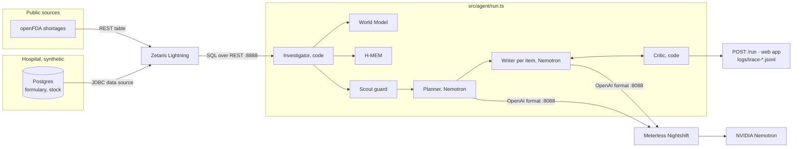

# Shortage Radar: architecture

> Shortage Radar doesn't guess what will run short. It tells a hospital buyer what to do about what just did.

Open Agent Hackathon 2026 · Track 02, *The Agent That Can Explain Why* · solo. This file describes what is built. The day-by-day reasoning, dead ends and fixes are in [docs/build-log.md](docs/build-log.md).

## 1. Pitch

The FDA drug shortage list is the source of truth for US drug supply and it is noisy: **746 of its 1,609 entries were updated in the week to 22 Oct 2026**, each one a package NDC from one company marked Available, Limited or Unavailable. A hospital pharmacy buyer has to work out, every morning, which changes touch *their* formulary, how many days of stock they have, and which NDC from which manufacturer they can safely buy instead.

Shortage Radar does that triage. It joins the hospital's private stock database with the FDA feed through **Zetaris**, tracks every product's status over time in a **World Model**, remembers the buyer's decisions in **H-MEM**, screens third-party text with **Scout Intent**, and has **Nemotron** (through **Meterless Nightshift**) plan the brief and write each item. A **Critic written in plain code** rejects any claim its evidence doesn't back.

What makes it different:

- **It does not predict shortages.** We tested the obvious signal, a recent recall of the same drug, against 142 shortages posted in 2025-26: it was *less* common before a shortage than for drugs that never went short (0.7-0.9x; [evidence](docs/evidence/2026-10-22-recall-backtest.md)). The agent reports exposure, runway and swaps.
- **The "why" is a chain of records.** Every sentence cites evidence ids that resolve to a Zetaris query id and its SQL, a World Model status history, or an H-MEM memory.
- **It gets quieter.** A decision the buyer already made stays out of the brief until the FDA status moves again.
- **A swap means the same strength.** The naive "same drug, marked available" list mixed 10 mg/mL with 20 mg/mL and lidocaine-in-dextrose drips; swaps are same-concentration only, everything else is "pharmacist review".

## 2. Problem and capability map

| | |
|---|---|
| **User** | The buyer at a 150-300 bed community hospital pharmacy, with no supply-chain analytics team. |
| **Today** | Checks the FDA and ASHP shortage pages, reads wholesaler allocation emails, keeps a spreadsheet, and often finds out when an order fails. |
| **Cost** | A 2019 [Vizient survey](https://vizientinc.com/newsroom/news-releases/2019/new-vizient-survey-finds-drug-shortages-cost-hospitals-just-under-360m-annually-in-labor-expenses) found US hospitals spend 8.6 million extra labor hours, just under $360 million a year, managing shortages. [ASHP counted a record 323 active shortages in Q1 2024](https://www.aha.org/news/headline/2024-04-12-ashp-reports-record-high-number-drug-shortages). |
| **Evidence we measured** | 1,609 FDA entries, 746 updated in 7 days, 1,046 in 30; 13 NDCs changed status between the 22 and 23 Oct feeds; 8 of them are on our hospital's formulary. |

| User flow | Sponsor capability | Test or evidence |
|---|---|---|
| Join hospital stock with the FDA list in one query | **Zetaris**: `fda.shortages` (REST table over openFDA) ⨝ `northwind_pg.*` (JDBC data source) | live traces; `tests/zetaris.test.ts` for the read-only guard |
| What changed since the last update; status on any date | **World Model**: bitemporal `shortage-state` and `discontinuation` edges per NDC, idempotent ingest of every snapshot | official runner 8/8; `tests/world-model-shortages.test.ts` |
| Remember "bought the alternate" / "do not substitute" | **H-MEM**: decision records with source and confidence, trust ledger, supersede-never-delete | official runner 13/13; `tests/hmem-decisions.test.ts` |
| Screen FDA free text and database rows before a model reads them | **Scout Intent**: two-pass guard, field-level withholding, credential redaction | official evals, precision 1.000, recall 0.980; `tests/scout-intent.test.ts` |
| Plan the brief and write each item | **Nemotron 3.5 Lightning via Nightshift**: OpenAI-format chat, model named on every trace line | `npm run nightshift:check`; live traces |
| Reject unsupported claims | Code Critic (not a model) | `tests/critic.test.ts` |

**Sponsor removal test.** Without Zetaris: no join between private stock and the public feed. Without the World Model: no "what changed", no history. Without H-MEM: every handled item re-alerts daily. Without Scout: a sentence planted in an FDA note goes into the model's context. Without Nightshift/Nemotron: no plan and no write-ups, only raw rows.

## 3. System overview

## 4. Components

| Component | Path | Role |
|---|---|---|
| Web app and API | `app/` | Next.js. Morning brief, named steps, evidence drawer with decision buttons, trace and engines tabs. `POST /api/run` (alias `/run`) takes the hackathon's JSON input and returns its JSON output; `?stream=1` streams trace events as NDJSON. `GET /api/status`, `DELETE /api/memory`. |
| CLI entry | `run.ts` | `npx tsx run.ts input_examples/example_1.json` runs one input headless and prints the JSON result. |
| Sweep | `src/agent/run.ts` | Ingest, Diff, Match, Alternatives, Brief, Critique. Bounded: 5-minute run budget, 2 critic refinements per item, 2 concurrent model calls. |
| Zetaris adapter | `src/adapters/zetaris.ts` | One Lightning SQL statement per call; bearer key, `X-Org-ID`, fresh `X-Request-ID`; 60 s timeout, 2 retries; refuses stacked statements and anything that is not SELECT, WITH, SHOW or DESCRIBE unless the caller is setup code; records and replays fixtures. |
| Nightshift adapter | `src/adapters/meterless.ts` | Runtime provider contract v4: URL normalization, token, `meterless-app` and `meterless-scope` headers, model discovery, unauthorized vs offline, reasoning switch, one retry on an empty reply; records and replays fixtures per run. |
| Sample mode | `src/adapters/mode.ts` | Request-scoped, never process-global, so a visitor's sample run cannot flip a live server. |
| World Model | `src/engines/world-model/` | Append-only JSONL event log, folded state, content-derived ids, bitemporal edges, single-writer queue. |
| H-MEM | `src/engines/hmem/` | Tiered memories, canonical hybrid ranking, trust ledger, preview-first sleep, approval-gated dreaming, conflict resolution that never deletes. |
| Scout Intent | `src/engines/scout-intent/`, `src/agent/untrusted.ts` | Pattern pack, Unicode folding, snippet pass; `untrusted.ts` is the only way text becomes a `GuardedContext`, and the prompt builder accepts nothing else. |
| Domain | `src/domain/` | `fda-shortages.ts` (snapshots into the World Model), `alternates.ts` (strength parsing and ranking), `decisions.ts` (H-MEM records). |
| Trace | `src/agent/trace.ts` | One JSONL line per action (agent, action, handoff, model, SQL, query id, rows, ms, status); secrets masked in the file and on stdout. |
| Hospital DB | `db/hospital/`, `docker-compose.yml` | Schema and a seeded synthetic formulary for "Northwind General" (82 lines, real NDCs, invented stock), read-only role for Zetaris. |
| Zetaris setup | `zetaris/`, `scripts/zetaris-setup.ts` | Lightning SQL that registers both sources; idempotent. |
| Snapshots | `data/snapshots/` | Gzipped FDA feeds, captured twice a day; same-day revisions saved separately. |

## 5. Data model

**World Model.** Entities: `product:ndc:<package_ndc>`, `company:fda:<name>`, `ingredient:substance:<name>`, `state:fda:<state>`. Every drug-side entity is keyed by an identifier, never by fuzzy name: look-alike drug names cause medication errors, so the resolver's merge bands (kept, and passing the official check) never see them. Relationships: `made-by`, `contains`, and two bitemporal slots per product, `shortage-state` and `discontinuation` (the feed lists some NDCs twice). A new edge in a slot closes the old one; nothing is deleted. Every write carries provenance.

**H-MEM.** One factual, long-term memory per decision, with source (`buyer:<id>`), confidence 0.9, entities (NDCs, ingredient) and the structured decision in `data`. An item is "handled" while its recorded FDA state equals the current one; it returns as "changed since decision" the moment the state moves.

**Hospital DB.** `formulary_item(ndc, generic_name, form, presentation, labeler, category, critical, ndc_source)` and `inventory(ndc, on_hand_units, daily_usage_units, reorder_point, wholesaler)`.

## 6. The flows that matter

**Morning sweep.** Zetaris returns the FDA feed; the World Model replays the saved snapshots and today's feed and reports what changed; one federated query joins formulary, stock and FDA status; H-MEM sets aside handled items; Scout screens every row; Nemotron chooses what to cover (thinking on); one Zetaris query returns every available same-drug product; for each item Nemotron writes (thinking off) and the Critic checks the draft against NDCs on the swap list, citation ids, day counts, causes the FDA note doesn't state, and prediction language, sending it back up to twice before falling back to plain deterministic text.

**Why.** Opening an item shows the cited records, each tied to a Zetaris query id whose SQL is one click away, plus the dated status history.

**Decide.** "Bought the alternate", "Do not substitute" or "Monitor" is stored in H-MEM and the item leaves the brief.

## 7. Reliability and judging

- `SAMPLE_MODE=true` (or the Sample toggle, or no reachable services) replays recorded Zetaris rows and model replies, exactly per example. A live run that cannot reach Zetaris or Nightshift falls back to the replay and reports it.
- Timeouts: Zetaris 60 s, Nightshift 60-120 s (a timed-out write is retried once at 90 s), whole run 5 minutes. Failures return `{status: "error", error: {type, message, recoverable}}`.
- Every run writes `logs/trace-<run_id>.jsonl` and prints readable lines. Sample runs write `…-sample.jsonl`.
- The Docker image installs and builds everything at build time, takes secrets only at run time, and binds `0.0.0.0`.

## 8. Stack and why

TypeScript on Node 22 throughout, because the Meterless reference engines and runners are TypeScript and our engines run against them directly. Next.js for the UI and API on one port (8000, since Zetaris's UI owns 3000). Vitest. Fonts and icons are bundled, so the UI needs no network. Postgres 16 in Docker for the hospital data; the engines are file-backed and need no infrastructure. The hackathon guide's example is Python (`run.py`); the contract is the same (`run.ts`, `POST /run`, JSON in and out).

## 9. Out of scope

Predicting shortages (tested, not supported by the data); placing orders; patient data of any kind; non-US regulators; auth and multi-hospital tenancy; Scout's intent routing and tool planning (only its guard stage is built).
