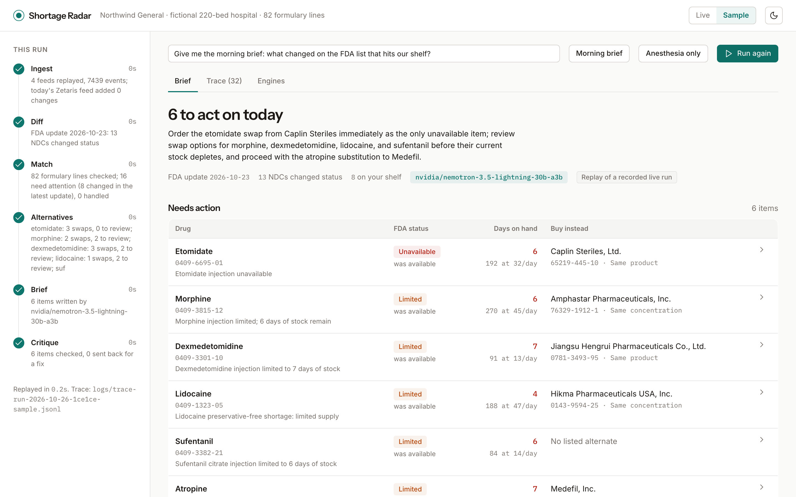
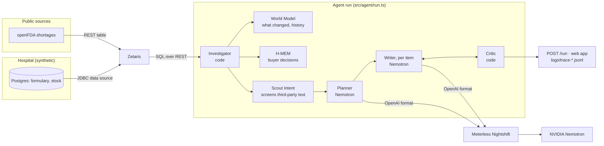
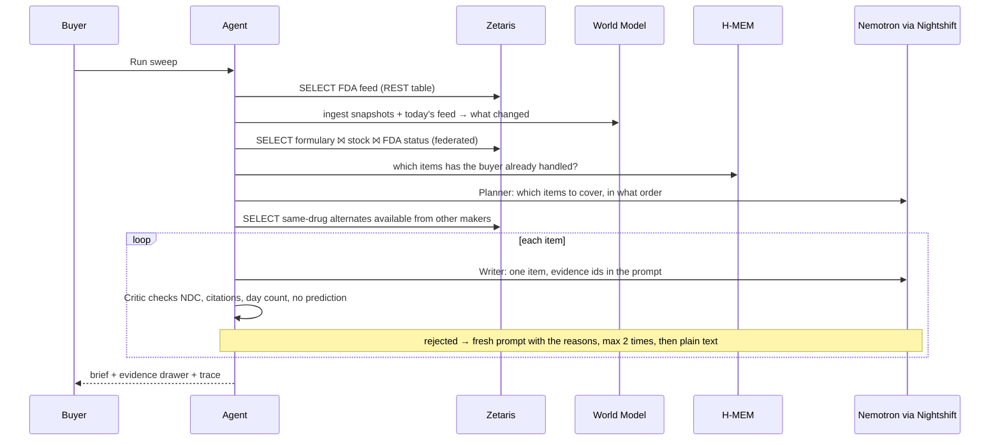

# Shortage Radar



### Shortage Radar doesn't guess what will run short. It tells a hospital buyer what to do about what just did.

[](#tests-and-evidence)
[](docs/evidence/world-model-conformance.md)
[](docs/evidence/hmem-conformance.md)
[](docs/evidence/scout-injection-evals.md)


An agent for a hospital pharmacy buyer. Every morning it checks the FDA drug shortage list against the hospital's own formulary and stock, works out how many days of stock each affected drug has left, finds a same-strength product from another manufacturer to buy instead, and writes a short brief in which every claim links to the query, record or memory behind it. It remembers what the buyer already decided, so it gets quieter over time.

**Track 02 · The Agent That Can Explain Why**, built on **Zetaris** (data layer), **Meterless** (World Model, H-MEM, Scout Intent, Nightshift) and **NVIDIA Nemotron**.

**Real:** the FDA shortage data (openFDA, live), the NDCs, every query through Zetaris, every model call through Nightshift to Nemotron. **Fictional:** the hospital, "Northwind General", whose stock levels are invented.

[**Watch the demo (3:54)**](https://youtu.be/xAKDnQNLiOQ) · [**Run it (2 minutes, no keys)**](#run-it) · [**Verify it yourself**](#verify-it-yourself-in-60-seconds) · [**Architecture**](ARCHITECTURE.md) · [**Build log**](docs/build-log.md)

## Demo

**[Demo video](https://youtu.be/xAKDnQNLiOQ)** (3:54, one real live run, narrated; nothing sped up). The slide deck was submitted with the entry on HackOS.

The app also runs in **Sample mode** on a fresh clone with no Zetaris, Nightshift or network: it replays a recorded live run, labelled as a replay, so what you see is what the live system produced.

## Verify it yourself in 60 seconds

```bash
git clone https://github.com/techbone/shortage-radar && cd shortage-radar && npm ci

npm run conformance:wm      # World Model, official runner       →  8/8 checks passed
npm run conformance:hmem    # H-MEM, official runner             →  13/13 checks passed
npm run evals:injection     # Scout, official eval runner        →  injection_precision 1.000, injection_recall 0.980 (2,316 cases)
npm test                    # unit + integration tests           →  76 passed

# the whole agent, offline, no keys:
SAMPLE_MODE=true npx tsx run.ts input_examples/example_1.json
```

The three official runners are copied **unmodified** from [Meterless/Meterless](https://github.com/Meterless/Meterless) with checksums in [conformance/README.md](conformance/README.md). Saved outputs of each run are in [docs/evidence/](docs/evidence/). The live traces of the three example runs, including the Nemotron model on every call, are in [logs/](logs/).

## Contents

[The problem](#the-problem) · [What it does](#what-it-does) · [Architecture](#architecture) · [The hard problems](#the-hard-problems) · [What's real and what's simplified](#whats-real-and-whats-simplified) · [Sponsor technology](#sponsor-technology) · [Run it](#run-it) · [Tests and evidence](#tests-and-evidence) · [Project layout](#project-layout) · [Limitations and disclosure](#limitations-and-disclosure)

## The problem

A hospital pharmacy buyer tracks drug shortages across the FDA's list, ASHP's list, wholesaler allocation emails and a spreadsheet, and often learns a drug is short when an order fails. The load is real: a 2019 [Vizient survey](https://vizientinc.com/newsroom/news-releases/2019/new-vizient-survey-finds-drug-shortages-cost-hospitals-just-under-360m-annually-in-labor-expenses) put the extra labor of managing shortages at more than 8.6 million hours and just under $360 million a year across US hospitals, and [ASHP counted a record 323 active shortages in Q1 2024](https://www.aha.org/news/headline/2024-04-12-ashp-reports-record-high-number-drug-shortages), the most since it began tracking in 2001.

The FDA list is the source of truth and it moves constantly. We measured it: **746 of its 1,609 entries were updated in the week to 22 Oct 2026**, one entry per package NDC per company. Working out which of those touch *your* shelf, how long your stock lasts, and what you can safely buy instead is manual, and the cost of getting the substitute wrong is a medication error.

Take out Zetaris and there is no join between the hospital's private stock data and the public feed, so no per-hospital answer. Take out the World Model and there is no "what changed", no status history. Take out H-MEM and every handled item re-alerts every morning, which is why alert tools get ignored. Take out Scout and a sentence planted in a third-party FDA note goes straight into the model's context.

## What it does

| Capability | What the buyer sees | What runs underneath |
|---|---|---|
| Match stock to the FDA list | "6 to act on today", each with FDA status, days on hand and what changed | **Zetaris**: one federated SQL statement joins the hospital's Postgres (`northwind_pg.*`, a JDBC data source) with the FDA feed (`fda.shortages`, a REST table). 3 queries per sweep, about 1.5 s each |
| What changed since the last update | "was available → now unavailable", with a dated status history | **World Model**: replays every saved FDA snapshot, bitemporal edges per product, idempotent ingest |
| Buy instead | A same-strength product from another manufacturer, with the reason it matches | Zetaris query for available alternates, then code that parses strengths and refuses to call a different concentration, a combination product or a preservative mismatch a swap |
| Explain why | A drawer per item: the evidence behind every sentence, the SQL, the status history | Evidence ids cited by the writer, resolved to Zetaris query ids, World Model records and H-MEM memories |
| Remember decisions | "Bought the alternate" removes the item until the FDA status moves again | **H-MEM**: decision records with source and confidence, a trust ledger, supersede-not-delete |
| Keep third-party text from steering the model | Nothing visible, which is the point | **Scout Intent**: every FDA note and database row is screened before a model sees it; only the poisoned field is withheld |
| Plan, write, check | Named steps while it runs (Ingest, Diff, Match, Alternatives, Brief, Critique) | **Nemotron 3.5 Lightning through Nightshift** plans and writes; a **Critic written in plain code** rejects any claim its evidence doesn't back and sends the draft back, up to twice |

## Architecture





Details, the component table and the data model are in [ARCHITECTURE.md](ARCHITECTURE.md).

## The hard problems

**Nemotron answered with nothing.** The first live request through Nightshift returned `502 empty_response`. Auth, routing and the model were all fine: our check had capped the reply at 80 tokens, and a reasoning model spends ~500 of them thinking before it writes a word. We raised the budget, then measured the other direction: turning thinking off with `chat_template_kwargs.enable_thinking=false` cuts a one-line reply from about 4 s and 400 tokens to under 1 s and 20 tokens. The Planner keeps thinking on, because choosing what matters is the judgement call; the per-item Writer turns it off, because the Critic checks every claim anyway. Details in [docs/build-log.md](docs/build-log.md).

**Same drug is not the same product.** The obvious "buy instead" query is "same ingredient, marked Available". It offered a 10 mg/mL lidocaine for a 20 mg/mL one and a premixed lidocaine-in-dextrose drip for a vial. `src/domain/alternates.ts` parses every strength to per-mL, drops combination products, treats a preservative-free product as different from a preserved one, and only calls something a swap at the same concentration. The Critic then refuses any `buy_instead` that isn't on that list or doesn't cite its own record. The tests use real FDA presentations ([tests/alternates.test.ts](tests/alternates.test.ts)).

**openFDA edits records without bumping its own date.** The live Zetaris feed disagreed with our saved snapshot on one NDC, though both said `last_updated: 2026-10-23`. The snapshot job skipped any day it had already saved. It now compares content and saves same-day revisions, and the World Model's diff between the live feed and the snapshots is what caught it.

**Poisoned FDA text must not blank the brief.** Scout's spec blocks the whole request when any snippet is poisoned, which turns one bad record into a denial of service. We guard per field, withhold only the poisoned one, and fence every piece of outside text so it cannot close its own block.

**We tested our first idea and dropped it.** We wanted to predict shortages from recalls. On 142 shortages posted in 2025-26, a recent recall of the same ingredient was *less* common before a shortage than for drugs that never went short (0.7-0.9x baseline, [evidence](docs/evidence/2026-10-22-recall-backtest.md)), and discontinuations are posted with zero days' notice. So the agent reports exposure, runway and swaps, and never forecasts.

## What's real and what's simplified

| Part | How it's backed | Status |
|---|---|---|
| FDA shortage data | openFDA live feed, read through a Zetaris REST table; saved snapshots for history | Real |
| Product identity | Real package NDCs from the FDA feeds | Real |
| Hospital formulary and stock | 82 lines with real NDCs and **invented** stock and usage in a Postgres container, registered in Zetaris as a JDBC data source | Simplified (synthetic) |
| Queries | Every number in the brief comes from a Zetaris statement (ids in the trace) | Real |
| Model | `nvidia/nemotron-3.5-lightning-30b-a3b` through Meterless Nightshift, named in every trace line | Real |
| Engines | World Model, H-MEM and Scout Intent are our implementations of the open specs, run against the official runners | Real, guard stage only for Scout |
| Sample mode | Replays recorded Zetaris rows and model replies, per example exactly | Replay of a real run |
| Ordering, wholesaler APIs, prices | Not built. The agent recommends; the buyer buys | Not built |
| Predicting shortages | Tested and rejected | Not built |

## Sponsor technology

- **Zetaris is the data layer.** The FDA feed is a `CREATE LIGHTNING REST TABLE` (cached, then flattened with `LATERAL VIEW explode`); the hospital database is a JDBC data source (`CREATE DATASOURCE … jdbcurl`). The agent's three queries are single Lightning SQL statements sent to `POST /sql-editor/sqls/run`, read-only by construction. Setup is in [zetaris/](zetaris/) and `npm run zetaris:setup`. The syntax for the JDBC source came from the parser's own error messages, recorded in the build log.
- **Meterless engines (three), each in a user-facing feature with a passing test.** World Model: "what changed" and the status history. H-MEM: the decision buttons and the Handled list. Scout Intent: the guard before every model call. See the Engines tab in the app, and [evidence](docs/evidence/).
- **Meterless Nightshift is the only AI provider.** `src/adapters/meterless.ts` implements the Runtime provider contract (URL normalization, bearer token, `meterless-app` and `meterless-scope` headers, model discovery, unauthorized vs offline); `npm run nightshift:check` runs the contract's three acceptance checks.
- **NVIDIA Nemotron.** `nvidia/nemotron-3.5-lightning-30b-a3b` does the planning and every item write-up, through Nightshift's NVIDIA provider. Each trace line records the model that answered, and the API response lists them in `models`. Nemotron's reasoning switch is a real design lever here (see above).
- **What is unique:** the same three engines carry the whole loop (what changed, what was decided, what is safe to read) rather than one bolted on, and the Critic is code that checks the model, instead of a second model agreeing with the first.

## Run it

There is no hosted link on purpose: Zetaris runs as local containers, so a public deployment could not reach the data layer. The app ships as a Docker image instead, which opens in Sample mode with no keys.

**Sample mode, no keys, no services** (what a judge needs):

```bash
docker build -t oah-submission .
docker run --rm -p 8000:8000 oah-submission          # open http://localhost:8000, press "Run sweep"
curl -X POST http://localhost:8000/run -H "Content-Type: application/json" \
     -d '{"input":{"query":"Give me the morning brief."},"options":{"sample_mode":true}}'
# or, without Docker:
npm ci && npm run build && npm start                  # http://localhost:8000
```

Without Zetaris and Nightshift the app opens in Sample mode on its own. `SAMPLE_MODE=true` makes every run a replay. If a live run cannot reach Zetaris or Nightshift, the API falls back to the replay and says so in the result.

**Live mode** needs [Zetaris](https://github.com/zetaris/getting-started) running locally and Meterless Nightshift with an NVIDIA key and a Nemotron lane:

```bash
cp .env.example .env                                   # fill in the two keys below
docker compose up -d hospital-db                       # the synthetic hospital database
npm run zetaris:setup                                  # registers the FDA feed and the hospital database in Zetaris
npm run nightshift:check                               # wrong token → unauthorized, auto-detect, a real Nemotron reply
npm run build && npm start                             # http://localhost:8000 → Live
npx tsx --env-file=.env run.ts input_examples/example_1.json   # or headless, JSON out
```

| Variable | Required | What it is |
|---|---|---|
| `ZETARIS_API_KEY` | live mode | API token created in the Zetaris UI (Management, API Tokens) |
| `ZETARIS_REST_URL`, `ZETARIS_ORG_ID` | no | defaults `http://localhost:8888/api/v1.0` and `1` |
| `METERLESS_RUNTIME_TOKEN` | live mode | Nightshift Runtime token, from Nightshift's Console |
| `METERLESS_BASE_URL`, `METERLESS_MODEL` | no | defaults `http://127.0.0.1:8088/v1` and `meterless/auto` |
| `SAMPLE_MODE` | no | `true` replays recorded runs, no services needed |
| `OPENFDA_API_KEY` | no | raises openFDA's rate limit for `npm run snapshot` |

Inside Docker, Zetaris and Nightshift on the host are reached at `host.docker.internal` (set automatically by `docker compose up app`). The NVIDIA key lives only in Nightshift's Providers tab and is never in this repo, `.env`, logs or traces. A live sweep takes about 40-160 s, bounded by a 5-minute budget.

**The `/run` API** takes `{"run_id", "input": {"query"}, "decisions": [...], "options": {"sample_mode", "max_items", "fallback", "replay_of"}}` (`replay_of` names the recorded example whose exact model replies a sample run should replay) and returns `{run_id, status, output, agents, models, trace_id, log_file, execution_time_seconds}`. `?stream=1` streams trace events as they happen. Failures return `{status: "error", error: {type, message, recoverable}}`. Three example inputs and their live outputs are in [input_examples/](input_examples/) and [output_examples/](output_examples/); example 3 shows H-MEM keeping two handled items out of the brief.

## Tests and evidence

| Check | Command | Result |
|---|---|---|
| World Model conformance (official runner) | `npm run conformance:wm` | 8/8 |
| H-MEM conformance (official runner) | `npm run conformance:hmem` | 13/13 |
| Scout injection evals (official runner + our FDA corpus) | `npm run evals:injection` | precision 1.000, recall 0.980 on 2,316 cases |
| Tests | `npm test` | 76 passing |
| Nightshift contract and live Nemotron request | `npm run nightshift:check` | [evidence](docs/evidence/nightshift-nemotron-check.md) |

The injection result has caveats written down: some of our cases were written while fixing misses, so the domain figures are optimistic, and on 6 attacks written after the rules it caught **0** (5 were then patched, Polish still gets through). The figures to trust are the official set and the 2,242 real FDA text fields, none of which was blocked. Full list of misses and fixes: [docs/evidence/scout-injection-evals.md](docs/evidence/scout-injection-evals.md).

## Project layout

```
app/                    Next.js web app and the /run API (the judge's front door)
run.ts                  Headless entry point: run one input, print JSON
src/agent/              run.ts (the sweep), brief.ts (prompts, Critic), data.ts (the Zetaris queries), untrusted.ts (the Scout gate), trace.ts
src/adapters/           zetaris.ts, meterless.ts (Nightshift), mode.ts (per-request sample mode)
src/engines/            world-model/, hmem/, scout-intent/: our implementations of the Meterless specs
src/domain/             fda-shortages.ts, alternates.ts, decisions.ts
zetaris/                Lightning SQL that registers the sources
db/hospital/            Postgres schema and the synthetic seed
data/snapshots/         saved FDA feeds (gzipped); data/fixtures/ recorded rows and replies for sample mode
conformance/, evals/    the official Meterless runners, unmodified, plus our corpus files
tests/                  Vitest
input_examples/, output_examples/, logs/    three examples, their live outputs and traces
docs/                   build-log.md (what broke and how we fixed it), evidence/ (saved test output)
```

## Limitations and disclosure

- The hospital is fictional and its stock is invented. No patient data is used anywhere. openFDA's disclaimer applies: do not rely on this data alone for medical care decisions. This is decision support; the buyer confirms with the label and the wholesaler.
- Alternate matching reads strengths from FDA presentation text. Presentations it cannot parse go to "Pharmacist review", never to a swap.
- Scout is pattern based and covers the guard stage of the spec, not intent routing or tool planning.
- The free NVIDIA endpoint has latency spikes (20-40 s seen) and occasional empty replies; the adapter retries once and the Critic loop falls back to plain text rather than fail.
- **Dependencies:** Next.js is on 15.5.28, past the December 2025 RSC advisory (CVE-2025-66478). `npm audit` still lists `postcss` inside Next's build tooling; it only reads our own CSS at build time, and the fix is a breaking jump to Next 16. See [docs/build-log.md](docs/build-log.md).
- Built for the Open Agent Hackathon 2026, Track 02, solo. First commit 23 Oct 2026. Built with Claude Code. No product code predates the build window; the engines follow the Apache-2.0 specs in [Meterless/Meterless](https://github.com/Meterless/Meterless), whose official test runners are included unmodified. The FDA data is public domain ([openFDA terms](https://open.fda.gov/terms/)).
